  

  
  
  
  

  <b>🇬🇧 English</b> · <a href="#-português">🇵🇹 Português</a>

<table align="center">
  <tr>
    <td align="center" width="25%"><b>🏆 Technical Excellence Award</b> PRIMAVERA · 2019</td>
    <td align="center" width="25%"><b>⏳ 17+ years</b> integration &amp; automation, since 2007</td>
    <td align="center" width="25%"><b>🎓 9 certifications</b> Cegid Primavera Academy, since 2012</td>
    <td align="center" width="25%"><b>🟢 In production</b> Community Platform · Repo Manager</td>
  </tr>
</table>

---

### 👋 Hi, I'm Bruno

Engineer and **R&amp;D lead**. I started debugging Primavera ERP integrations in 2007; today I build **applied-AI products** that run in production — not in slides. Under **[BolaLabs](https://github.com/BolaLabs)** I solve the hard processes: ERP and banking integrations, workflow automation, analytics dashboards, SQL performance and private, on-prem AI.

> With or without AI, the goal is the same: reliable systems that give teams their time back.

### ✨ Featured projects

<table>
  <tr>
    <td width="50%" valign="top">
      <h4>🧭 <a href="https://github.com/brunobola-portfolio/GitHub-Repo-Manager">GitHub Repo Manager</a></h4>
      One dashboard for repositories, teams and CI/CD — a cross-repo Work Board with DORA metrics, AI Deep Review and Azure DevOps/TFVC → GitHub migration.  
      
      
      
    </td>
    <td width="50%" valign="top">
      <h4>🏛️ <a href="https://github.com/brunobola-portfolio/community-platform">Community Platform</a></h4>
      Open-source, white-label platform for associations, clubs and institutions: members, events with account-free registration, dues, news and an AI assistant — run by the board from its own back-office.  
      
      
      
    </td>
  </tr>
  <tr>
    <td width="50%" valign="top">
      <h4>🤖 <a href="https://github.com/BolaLabs/AITOOL">AITOOL for Primavera</a></h4>
      An AI assistant inside the Primavera ERP: it answers from your data, fills windows, creates documents, receipts and approvals. Your model, your machines — nothing is saved without your click.  
      
      
      
    </td>
    <td width="50%" valign="top">
      <h4>🎨 <a href="https://github.com/brunobola-portfolio/t3-code-labs">T3 Code Labs</a> · <a href="https://github.com/brunobola-portfolio/t3code-session-manager">Session Manager</a> · <a href="https://github.com/brunobola-portfolio/claude-session-namer">Session Namer</a></h4>
      Tooling for AI coding agents: an observability-first theme for T3 Code, a manager that brings every Claude Code, Codex, Pi and OpenCode session into T3 Code, and readable <code>&lt;project&gt; - &lt;topic&gt;</code> session titles.  
      
      
    </td>
  </tr>
</table>

### 🛠️ What I work with

  
  
  
  
  
  
  
  
  
  
  
  

  

---

### 🇵🇹 Português

**Olá, sou o Bruno Silva Marques** — engenheiro e líder de I&amp;D. Comecei a depurar ligações ao ERP Primavera em 2007; hoje, com **17+ anos em integração de sistemas empresariais**, construo **produtos de IA aplicada** que correm em produção, não em slides. Na **[BolaLabs](https://github.com/BolaLabs)** resolvo os processos difíceis: integrações com ERP e banca, automação de workflows, dashboards analíticos, performance SQL e IA privada on-prem.

> Com ou sem IA, o objetivo é o mesmo: sistemas fiáveis que devolvem tempo às equipas.

**Projetos em destaque**

- 🧭 **[GitHub Repo Manager](https://github.com/brunobola-portfolio/GitHub-Repo-Manager)** — um painel para repositórios, equipas e CI/CD, com Work Board entre repositórios, métricas DORA, AI Deep Review e migração Azure DevOps → GitHub. *Em produção.*
- 🏛️ **[Community Platform](https://github.com/brunobola-portfolio/community-platform)** — plataforma open source para associações, comunidades e instituições: sócios, eventos, quotas, notícias e um assistente de IA, gerida pela direção no seu próprio backoffice. *Em produção em arcva.pt.*
- 🤖 **[AITOOL para Primavera](https://github.com/BolaLabs/AITOOL)** — assistente de IA dentro do ERP: pergunta, preenche janelas, cria documentos, recibos e aprovações. Nada é gravado sem o seu clique.
- 🎨 **[T3 Code Labs](https://github.com/brunobola-portfolio/t3-code-labs)**, **[Session Manager](https://github.com/brunobola-portfolio/t3code-session-manager)** e **[Session Namer](https://github.com/brunobola-portfolio/claude-session-namer)** — ferramentas para coding agents: tema para o T3 Code, gestor de sessões e títulos legíveis.

🏆 Technical Excellence Award — PRIMAVERA 2019 · 🎓 9 certificações Cegid Primavera Academy desde 2012 · 📘 Mestrado em Gestão de Sistemas de Informação Médica (IPLeiria + FMUP)

  

---

  <b>Bruno Silva Marques</b> · <a href="https://github.com/BolaLabs">BolaLabs</a> · part of <a href="https://elevatingsolutions.pt">Elevating Solutions</a> · <a href="https://bolalabs.pt">bolalabs.pt</a>

